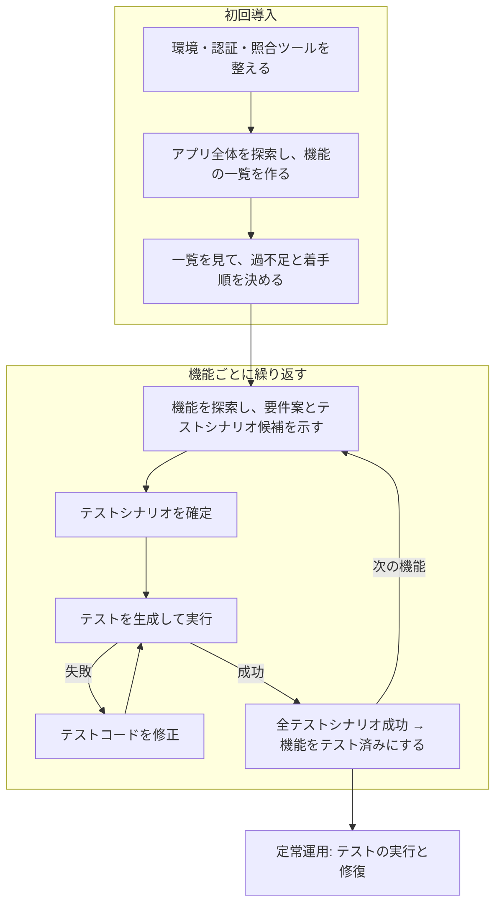

# sample-e2e-testing-skill

Playwrightと[playwright-cli](https://github.com/microsoft/playwright-cli)を使って、E2Eテストをゼロから対話的に作り、実行するためのAgent Skillです。

要件定義書やテストシナリオが無くても使えます。エージェントがアプリを実際に操作して動きを調べ、要件とテストシナリオを提案し、テストコードまで作ります。提案に添えられた疑問点に答えると、要件とテストシナリオが確定します。

要件定義書やテストシナリオがあれば、エージェントはそれを読んでアプリの動きと突き合わせ、資料に基づいた要件とテストシナリオを提案します。

要件とテストシナリオは[Gherkin](https://cucumber.io/docs/gherkin/)記法で記載されたテストの仕様書になり、エージェントはそこからPlaywrightのテストコードを作って実行します。仕様書とテストの対応は、同梱の照合ツールが担保します。

## スコープ

このスキルにおけるE2Eテストとは、利用者がブラウザで行う一連の業務の操作を、画面から始めて結果が画面に表れるまで通して確かめるテストです。テスト対象のアプリは、画面からデータベースなどの永続化層まで本物の構成要素をつないだ、本番相当の検証環境で動かします。テストは利用者と同じようにブラウザの画面を操作し、画面に表れた結果で合否を判断します。

次のものは扱いません。

- 性能テスト、使いやすさの評価、アクセシビリティ監査
- API単体のテストと、バックエンドとつながない画面部品のテスト

## できること

| 依頼の例 | 動き |
|---|---|
| 「このアプリのE2Eテストを作りたい」 | アプリを調べて機能の一覧を作り、機能ごとに要件案とテストシナリオ候補を示す。あなたが確定したテストの仕様書からテストを生成して実行する |
| 「この要件定義書を元にテストを作って」 | 資料とアプリの食い違いを示し、出典(`# 引用元:`)付きの要件案とテストシナリオ候補を示す |
| 「E2Eテストを回して」 | データを初期化して全体を実行し、証跡を`evidence/`に残して、不整合と機能ごとの集計を報告する |
| 「E2Eテストが落ちた」 | 1件ずつ観察し、テストコードの問題は直す。テストシナリオの誤りとアプリのバグの疑いはあなたに確認する |
| 「この機能を変更した。テストを追随させて」 | 機能を調べ直し、テストシナリオの変更案を示してからテストを作り直す |
| 「コメントを書いたreview.csvを反映して」 | テストの仕様書の変更前と変更後を示し、あなたの判断を得てから書き換える |
| 「テストの抜けを洗い出して」 | カバレッジを取りながら全体を実行し、一度も通らなかったハンドラや分岐を示す |

## 全体フロー

エージェントは探索・生成・実行・修復を自律的に進め、あなたの判断が必要な箇所(機能の取捨と着手順、テストシナリオの確定と変更、バグ疑いの判断)だけで止まります。



## 動作要件

- OS: macOS、Linux、Windows(PowerShell 5.1以降)。対応するバージョンはPlaywrightに従います
- Node.js: 22.18以上(npm / npxを含む)。照合ツールとビューアはNodeだけで動きます
- エージェント: [Agent Skills](https://agentskills.io/)に対応し、シェルのコマンドを実行できるAIエージェント
- Playwrightとブラウザ: 事前のインストールは不要です。Playwrightのプロジェクトが無ければ、最初の導入のときにエージェントが`npm init playwright@latest`を実行して入れます
- カバレッジ機能を使う場合だけ、テスト対象のアプリの言語のツールが要ります
  - Java / Kotlin: JDKとJaCoCoの配布物(`jacocoagent.jar` / `jacococli.jar`)
  - Go: 1.20以上
  - Node.js: c8(npxで実行)
  - Python: coverage.py 7.5以上(マルチプロセスのアプリは7.10以上)
  - Windowsでネイティブに動かすアプリではJava / Kotlinだけが対象です。Go / Node.js / PythonのアプリはDocker(Linuxコンテナ)で動かしてください

## 前提のインストール

1. Node.js 22.18以上(`node --version`で確認)

2. playwright-cli(CLI本体)

   ```bash
   npm i -g @playwright/cli@latest
   ```

3. playwright-cliスキル(ブラウザ操作・テストデバッグの基盤。本スキルはこれに依存します)

   ```bash
   npx skills add microsoft/playwright-cli --skill playwright-cli -g
   ```

   [skills CLI](https://github.com/vercel-labs/skills)でGitHubのmicrosoft/playwright-cliからインストールします。`--skill playwright-cli`は同じリポジトリにある別のスキルを入れないための指定です。

## 本スキルのインストール

1. [Releases](https://github.com/aws-samples/sample-e2e-testing-skill/releases/latest)のAssetsから`sample-e2e-testing-skill-<バージョン>.zip`をダウンロードして展開します

2. zipを展開した場所(`sample-e2e-testing-skill`ディレクトリができた場所)で、[skills CLI](https://github.com/vercel-labs/skills)を使ってインストールします。`-g`はユーザー単位でインストールする指定です

   ```bash
   npx skills add ./sample-e2e-testing-skill/skills/e2e-testing -g
   ```

   スキルはユーザーのディレクトリにコピーされるので、展開したディレクトリは消してかまいません。新しいバージョンにするときは、新しいzipで同じ手順を繰り返します。

## 使い方

エージェントに日本語でやりたいことを伝えるだけです。何から始めるか迷ったら、次のように頼んでください。

> E2Eテストを始めたい。次に何をすればいい?

エージェントが現在地(未導入 / 定義途中 / テスト済み)を判定して進めます。進捗は`features/feature-map.json`に記録されるので、セッションを跨いで再開できます。

## プロジェクトに生成されるもの

```
features/
├── feature-map.json      # 機能一覧と進捗(再開の起点)。要件文で使うアプリ名 `app`、カバレッジを使う場合は計測コマンドもここに記録
├── last-run.json         # 最後の全体実行の結果の控え(照合ツールが書く。手編集禁止。コミットする)
├── <機能>.feature        # Gherkin のテストシナリオ(英語キーワード+日本語本文)。Rule に要件 ID 付きの EARS 要件文、Scenario にテストシナリオ ID(タグ + 名前先頭)
└── viewer/               # 要件とテストシナリオの表(index.html。ブラウザで直接開く)とレビュー用の CSV(review.csv)。ビューアが作り直す(手編集禁止。コミットする)
scripts/
└── e2e-trace.mts  # 照合ツール(最初の導入のときにスキルの原本をコピー。`npm run e2e:trace` で実行)
tests/
├── auth.setup.ts         # ロールごとにログインして認証状態を保存(認証がある場合)
├── fixtures.ts           # seed fixture
├── seed.spec.ts          # 探索・生成の起点(ロールごとに 1 test)
└── e2e/<機能>/<シナリオ ID>-<シナリオ>.spec.ts   # Playwright のテストコード(test 名の先頭と tag にテストシナリオ ID)
playwright/.auth/<ロール>.json   # 認証状態(コミット禁止)
test-results/results.json  # 最新実行の JSON レポート(照合ツールが読む。コミット禁止)
evidence/<実行ID>/         # 実行ごとの証跡(コミット禁止)。カバレッジ付き実行では coverage/ にレポートも入る
evidence/coverage-raw/     # カバレッジ計測の作業場所(実行のたびに空にする)
```

最初の導入のときに、エージェントは`playwright.config.ts`・`package.json`・`.gitignore`・`.gitattributes`も変更します。既存の`playwright.config.ts`があれば、足りない設定だけを追加します。

## ご利用にあたっての注意

- このリポジトリはサンプルです。本番環境のアプリを操作してテストを作ったり実行したりすることは想定していません。業務で使う前に、所属組織のセキュリティ・法務の担当者と、セキュリティ・規制・コンプライアンスの要件を満たすかを確認してください
- エージェントはテスト対象のアプリを実際に操作し、データ初期化のコマンド(`e2e:reset-data`)も実行します。検証用の環境で、テスト用のアカウントとデータを使ってください
- 信頼できないサイトやアプリを対象にしないでください。画面の文言や入力値がエージェントへの指示として働くことがあります(プロンプトインジェクション)
- 証跡(`evidence/`)・トレース・スクリーンショット・`review.csv`には、テスト対象のアプリに表示された文字や入力した値がそのまま残ります。個人情報や秘密を含む画面を扱った場合は、共有する前に中身を確認してください。認証状態(`playwright/.auth/`)と`.env`はコミットしないでください

## コントリビューション

不具合の報告と変更の提案の方法は[CONTRIBUTING.md](CONTRIBUTING.md)を見てください。このプロジェクトは[Amazon Open Source Code of Conduct](CODE_OF_CONDUCT.md)を採用しています。

## セキュリティ

セキュリティ上の問題を見つけた場合は、公開のissueを作らず、[CONTRIBUTING.md](CONTRIBUTING.md#security-issue-notifications)の手順で報告してください。

## ライセンス

MIT-0ライセンス(MIT No Attribution)です。[LICENSE](LICENSE)を見てください。

ビューアの`skills/e2e-testing/viewer/build.mjs`には第三者のソフトウェア(React、react-dom、CucumberのGherkinパーサー、書体Atkinson Hyperlegible Next)を取り込んでいます。MIT-0はこれらには及ばず、それぞれのライセンスは[THIRD-PARTY-LICENSES](THIRD-PARTY-LICENSES)にあります。
